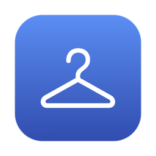

<p align="center">
  
</p>

<h1 align="center">LiangYiJia / 晾衣架</h1>

<p align="center">
  <b>中文</b> | <a href="#english">English</a>
</p>

<p align="center">
  
  
  
  
</p>
<p align="center">
  
  
  
  <a href="https://github.com/hwl513782273/LiangYiJia/releases/latest"></a>
</p>


---

<p align="center">
  <a href="https://github.com/hwl513782273/LiangYiJia/releases/latest">下载最新版 / Download</a>
  ·
  <a href="https://github.com/hwl513782273/LiangYiJia/issues">问题反馈 / Issues</a>
</p>

> 截图、复制的文字、链接、图片，全都挂到屏幕顶上的一根绳子上：指针靠上去绳子滑下来，点一下复制，按 Delete 扔掉这一张。像一块随手可用的「临时暂存架」，只不过它只有一根线。 / Screenshots, copied text, links and images all hang on a thin line at the top of your screen. Rest the pointer on it and the line glides down, click to copy, press Delete to drop that one. A temporary shelf for everything you just copied — except it is only a line.
>
> **作者 Author：banqiu** **许可证 License：MIT**（详见 LICENSE）。可自由使用、修改与再分发，须保留版权与许可声明。

## 中文

### 主要功能

- **一根线，什么都挂**：截图自动挂上；复制来的**文字**、**网址**、**图片**也都能挂（文字卡显示前几行并标出总字数，链接卡显示域名 + 网页标题 + 完整地址）。开关在菜单栏「挂上复制的内容」，默认关闭，第一次要自己打开。
- **悬停 0.35 秒就放大预览**：文字卡和链接卡给你看**原文全文**（不是放大图片），图片卡给看放大的原图（最多 3 倍）。鼠标移开 0.3 秒收起。
- **一个手势一件事**：点一下复制、长按进「标记」、双击进「预览」、用力点快览、拖进 App 发一份（卡片留在线上）、拖进文件夹存下来（卡片离开线上）、拖到废纸篓或点叉让它走。
- **超限清理看得见**：线挂满后再复制，绳子先滑到最老一头，把「要掉的那张」和它后面那张一起摆到你眼前，再照原样掉下去，后面那张立刻补位，0.9 秒后滑回最新。不再是默默删掉、你只看到整排跳一下。
- **鼠标停着按 Delete 直接删**：不用去够那个小叉。只在指针确实停在卡片上时生效，移开立刻恢复成普通删除键；带 ⌘ / ⌥ / ⌃ 的组合不受影响。
- **一直显示**：菜单里勾上「一直显示」，绳子常驻屏幕顶上，指针移开也不收；线上空了就把空绳子留在原地。全屏 App 挡住时会自动收起（刻意保留），退出全屏自动回来。
- **纯原生、纯离线**：Swift + AppKit/SwiftUI 写成的一个 `.app`，没有第三方依赖、不联网、不上传任何东西。

> **平台说明 Platform Note：本工具为 macOS 原生应用（Swift + AppKit/SwiftUI，打包为 `.app` / `.dmg`），需要 macOS 12 及以上，Intel 与 Apple Silicon 通用（universal 二进制，一个包两种芯片）。暂无 Windows / Linux 版本。**

### 快速开始

1. 在 [Releases](https://github.com/hwl513782273/LiangYiJia/releases/latest) 下载 `12-LiangYiJia-1.0.0-universal.dmg`。
2. 打开 DMG，把 `晾衣架.app` 拖进「应用程序」。
3. 首次打开：右键 → 打开（或终端执行 `xattr -dr com.apple.quarantine /Applications/晾衣架.app`）。
4. 启动后会问「让晾衣架接管你的截图？」——点**开启**。之后照常截图，卡片就挂上来了；指针移到屏幕顶端中间，绳子滑下来。

从源码构建（需 macOS 14+ 与 Swift 5.9 工具链，即 Xcode 15 及以上的命令行工具）：

```
git clone https://github.com/hwl513782273/LiangYiJia.git
cd LiangYiJia
# 默认编 universal（arm64 + x86_64）；只想要本机架构、省一半时间：ARCHS=arm64 bash scripts/build-app.sh release
bash scripts/build-app.sh release
cp -R build/晾衣架.app /Applications/
open /Applications/晾衣架.app
```

打包 DMG（需 macOS 自带 `hdiutil`，把 `1.0.0` 换成实际版本号）：

```
hdiutil create -volname "LiangYiJia 1.0.0" -srcfolder "build/晾衣架.app" -ov -format UDZO "12-LiangYiJia-1.0.0-universal.dmg"
```

改版细节与踩坑记录（为什么这么实现）另见 [docs/CHANGES.zh-Hans.md](docs/CHANGES.zh-Hans.md)。

### macOS 版本选择

- **Intel Mac 与 Apple Silicon 通用 — 一个包就够**：下载 `12-LiangYiJia-1.0.0-universal.dmg`。里面是 arm64 与 x86_64 两个切片粘成的 universal 二进制，macOS 12（Monterey）及以上都能跑。

> 不再分开发 arm64 / x86_64 两档：universal 一个文件同时覆盖两种芯片，下载时不用挑。DMG 为 ad-hoc 签名、**未公证（notarized）**，首次打开请右键「打开」放行 Gatekeeper。

> 仓库「发行版 / Releases」的命名格式为：`支持最低版本-LiangYiJia-版本-架构`（如 `12-LiangYiJia-1.0.0-universal.dmg`）。第一段数字为该包实际支持的最低 macOS 版本号。

### 支持的功能

| 类别 | 项目 | 说明 |
|------|------|------|
| 挂上什么 | 截图 | 接管截图文件夹，新截图自动挂到线上；也可以不接管，只手工拖进来 |
| 挂上什么 | 文字 | 复制来的纯文本画成文字卡（220pt 宽，超长截断并标总字数），点一下把原文全文放回剪贴板 |
| 挂上什么 | 链接 | 网址画成链接卡（域名 + 网页标题 + 完整地址），点一下把原网址放回剪贴板 |
| 挂上什么 | 图片 | 复制来的图片以原图落盘，不重绘；点一下照旧复制图片 |
| 手势 | 点击 / 长按 / 双击 / 用力点 | 复制 / 进「标记」/ 进「预览」/ 快览 |
| 手势 | 拖拽 | 拖进 App 发一份（卡片留在线上）、拖进文件夹存下来（卡片离开线上）、拖到废纸篓扔掉 |
| 手势 | 悬停 / Delete / ⌘Z / 空格 | 0.35 秒弹出放大预览 / 删掉这一张 / 把刚扔掉的挂回去 / 快览 |
| 容量 | 同时显示几张 | 按屏幕宽度自动算 `(屏宽 - 200) ÷ 174`，上限 12、下限 3；1920 宽的屏 = 9 张 |
| 容量 | 保留上限 | 默认等于可显示张数，也可固定 25 / 50 / 100 张；超出时最旧的一张移入废纸篓 |
| 容量 | 回看更早的 | 两指滑动或滚轮；只有保留数大于可显示张数时才有前后可翻 |
| 多屏 | 显示在哪块屏 | 菜单「显示在」：跟随鼠标指针 / 主显示器 / 逐一指定某块屏。按显示器 UUID 记住，外接屏拔掉回落主屏、插回来自动回去；钉住后新内容不会把线拽到别的屏 |

### 差异化亮点

- 🧺 **一根线就是全部界面**：没有窗口、没有侧栏、没有列表，指针离开就消失，不占地方也不抢焦点。
- 📋 **复制什么都挂得住**：原本只认截图，现在文字、链接、图片都行——把「随手暂存」这件事从截图扩展到全部剪贴板内容。
- 🔍 **悬停看原文，不是看放大的糊图**：文字卡直接把全文摊开给你，长链接也不用眯着眼猜。
- 👀 **清理不再是「看不见的一下」**：超限删最老那张时，绳子会先滑过去让你看清是哪张要掉，再照原样掉下去。
- ⌨️ **停在卡片上按 Delete 就删**：不用瞄准那个小叉；靠 Carbon 热键实现，不需要「输入监控」这类敏感授权。
- 📌 **可以一直挂着**：当临时暂存架用的时候，绳子常驻，不会你手一移开就收走。
- 🪶 **一个 App，零依赖，零联网**：Swift 原生、全部本地运行，不装后台服务、不写系统任何位置。

### 已知限制

- **macOS 12 / 13 与 Intel 机器没有实机验证**：这个包确实是 arm64 + x86_64 的 universal 二进制，最低系统也标成了 12.0，编译和 API 版本检查都过了；但发布者手上只有 Apple Silicon 的新系统，**没有 macOS 12 / 13 真机、也没有 Intel 机器实际跑过**。如果你在那边遇到界面错位、卡片位置偏移之类的问题，请开 issue 并附上截图和 `sw_vers` 输出。
- **ad-hoc 签名，每次重新编译都要重新授权**：没有开发者证书，每次重编 macOS 会把 App 当成新程序，重新问一次截图文件夹的访问权限，也会重新弹一次 Gatekeeper 放行。没有自动更新，上游更新的合并要自己做。
- **双开必挂两遍**：不要和原版 Tendedero 或其他剪贴板接管程序同时运行，会重复监听同一个文件夹，同一条内容挂出两张。
- **剪贴板监听只看「有没有隐私标记」**：密码管理器、浏览器隐私复制会打 `org.nspasteboard.ConcealedType` 一类标记，命中即丢弃；但**没有标记的敏感内容照样会挂**（例如从终端复制的令牌、密钥）。全自动监听本质上就有这个风险，不用的时候把「挂上复制的内容」关掉。
- **不做「拖到线上排序」和「多屏分别一根线」**：多显示器时只覆盖主屏，拖拽只支持「往外送」，不支持在线上挪位置。

## English

### Highlights

- **One line, holds everything**: screenshots hang automatically; copied **text**, **urls** and **images** hang too. Text cards show the first lines plus a total character count, link cards show domain, page title and the full address. The toggle lives in the menu bar ("挂上复制的内容") and is off by default.
- **Hover 0.35 s for a large preview**: text and link cards show the **actual full text** (not a blown-up bitmap), image cards show the enlarged original up to 3×. It folds away 0.3 s after the pointer leaves.
- **One gesture per intention**: click to copy, press and hold for Markup, double click for Preview, force click to Quick Look, drag into an app to send a copy (the card stays), drag into a folder to keep it (the card leaves), drag to the Trash or hit the cross to let it go.
- **Overflow cleanup you can see**: when the line is full, it first slides to the oldest end so you can watch which photo is about to drop, drops it with the original animation, immediately pulls the next one into place, then slides back to the newest after 0.9 s.
- **Delete removes whatever you hover**: the pointer is already there, no need to aim at the little cross. It only arms while the pointer is really on a card, so the key returns to normal the moment you move away.
- **Always shown**: tick "一直显示" in the menu and the line stays up, empty or not, even after the pointer leaves. It still hides behind full-screen apps on purpose and comes back when you leave full screen.
- **Native, offline, zero dependencies**: one Swift `.app` built with AppKit and SwiftUI. No third-party libraries, no network access, nothing uploaded anywhere.

> **Platform Note: this is a native macOS app (Swift + AppKit/SwiftUI, packaged as `.app` / `.dmg`). It needs macOS 12 or later, on Intel and Apple Silicon alike (a single universal binary). There is no Windows / Linux build.**

### Quick start

1. Download `12-LiangYiJia-1.0.0-universal.dmg` from [Releases](https://github.com/hwl513782273/LiangYiJia/releases/latest).
2. Open the DMG and drag `晾衣架.app` into "Applications".
3. First launch: right-click → Open (or run `xattr -dr com.apple.quarantine /Applications/晾衣架.app`).
4. On launch it asks "让晾衣架接管你的截图？" — choose **开启**. Take a screenshot as usual and the card appears; rest the pointer in the middle of the top edge and the line glides down.

Build from source (requires macOS 14+ and the Swift 5.9 toolchain, i.e. Xcode 15 or newer command line tools):

```
git clone https://github.com/hwl513782273/LiangYiJia.git
cd LiangYiJia
# 默认编 universal（arm64 + x86_64）；只想要本机架构、省一半时间：ARCHS=arm64 bash scripts/build-app.sh release
bash scripts/build-app.sh release
cp -R build/晾衣架.app /Applications/
open /Applications/晾衣架.app
```

Package the DMG (uses the bundled `hdiutil`; replace `1.0.0` with the real version):

```
hdiutil create -volname "LiangYiJia 1.0.0" -srcfolder "build/晾衣架.app" -ov -format UDZO "12-LiangYiJia-1.0.0-universal.dmg"
```

Implementation notes and the pitfalls behind each decision are in [docs/CHANGES.zh-Hans.md](docs/CHANGES.zh-Hans.md) (Chinese).

### Choose a macOS build

- **Intel and Apple Silicon alike — one build fits all**: download `12-LiangYiJia-1.0.0-universal.dmg`. It is a universal binary (arm64 + x86_64 slices) and runs on macOS 12 (Monterey) or later.

> There are no separate arm64 / x86_64 downloads: one universal file covers both chip families, so there is nothing to pick wrong. The DMG is ad-hoc signed and **not notarized**; right-click → Open on first launch to pass Gatekeeper.

> Release naming format: `minimum-macOS-version-LiangYiJia-version-arch` (e.g. `12-LiangYiJia-1.0.0-universal.dmg`). The first number is the minimum macOS version the package actually supports.

### Supported features

| Category | Item | Description |
|----------|------|-------------|
| What hangs | Screenshots | Takes over the screenshot folder and hangs new screenshots automatically; or leave that off and drag files in by hand |
| What hangs | Text | Copied plain text becomes a text card (220 pt wide, truncated with a total character count); clicking puts the full original text back on the clipboard |
| What hangs | Links | A URL becomes a link card (domain, page title, full address); clicking puts the original URL back on the clipboard |
| What hangs | Images | Copied images are stored as originals, never re-rendered; clicking copies the image as before |
| Gestures | Click / hold / double click / force click | Copy / open in Markup / open in Preview / Quick Look |
| Gestures | Drag | Into an app to send a copy (card stays), into a folder to keep it (card leaves), to the Trash to let it go |
| Gestures | Hover / Delete / ⌘Z / Space | Large preview after 0.35 s / drop this one / hang back what you just dropped / Quick Look |
| Capacity | Visible cards | Computed from screen width, `(width - 200) ÷ 174`, clamped to 3–12; a 1920-wide screen shows 9 |
| Capacity | Retention limit | Defaults to the visible count, or pin it to 25 / 50 / 100; the oldest is moved to the Trash when over the limit |
| Capacity | Scrolling back | Two-finger scroll or the wheel; only meaningful when retention exceeds the visible count |
| Displays | Which screen it hangs on | Menu “Show on”: follow the pointer / the main display / one specific display. Remembered by display UUID, so unplugging falls back to the main display and plugging back in returns automatically; once pinned, new items no longer drag the line to another screen |

### Why this tool

- 🧺 **The line is the whole interface**: no window, no sidebar, no list. It disappears when the pointer leaves, so it never gets in the way or steals focus.
- 📋 **Anything you copy can hang**: the original only took screenshots; now text, links and images work too, which turns "quick stash" into something that covers the whole clipboard.
- 🔍 **Hover shows the real text, not a blurry enlargement**: long text is laid out in full and long URLs stop being a guessing game.
- 👀 **Cleanup is no longer an invisible jump**: when the oldest card has to go, the line slides over so you can see which one it is before it drops with the original animation.
- ⌨️ **Delete removes the card under the pointer**: no aiming at the tiny cross, implemented with Carbon hot keys so no Input Monitoring permission is needed.
- 📌 **It can stay up all day**: when you use it as a shelf, the line stays put instead of retracting the moment your hand moves.
- 🪶 **One app, no dependencies, no network**: native Swift, everything local, no background service and nothing written outside its own folder.

### Known limitations

- **No hands-on testing on macOS 12 / 13 or on Intel**: the package really is a universal binary (arm64 + x86_64) with a minimum of macOS 12.0 and it compiles against the macOS 12 SDK, but the maintainer only has an Apple Silicon machine on a recent macOS, so **it has never been run on macOS 12 / 13 or on real Intel hardware**. If layout looks off there, please open an issue with a screenshot and the output of `sw_vers`.
- **Ad-hoc signed, so every rebuild asks again**: without a developer certificate each rebuild looks like a new app to macOS and has to be re-granted folder access and re-approved by Gatekeeper. There is no auto-update; merging upstream changes is manual.
- **Never run two copies**: do not run the original Tendedero or any other clipboard-takeover app alongside this one, or the same folder is watched twice and every item hangs twice.
- **Clipboard monitoring only honours privacy markers**: password managers and private browser copies set `org.nspasteboard.ConcealedType` style markers and are dropped, but **unmarked sensitive content still hangs** — a token or key copied from a terminal, for example. Automatic monitoring carries that risk by nature; turn "挂上复制的内容" off when you do not need it.
- **No reordering on the line and no per-display lines**: with multiple monitors only the main screen gets a line, and dragging only works outward, never to rearrange cards.

## 隐私与安全 / Privacy and security

- 图片、文字、链接全部只存在你自己的机器上（截图文件夹里的一张张 PNG），不上传、不同步、不联网；App 里没有任何网络请求代码。 / Images, text and links stay on your own machine as PNG files in the screenshot folder. Nothing is uploaded, synced or sent anywhere, and the app contains no networking code.
- 需要的权限只有一项：访问你指定的截图文件夹（由 macOS 弹窗询问，随时可在「系统设置 → 隐私与安全性 → 文件与文件夹」里撤销）。用 Delete 键删除靠 Carbon 热键实现，不需要「输入监控」或「辅助功能」授权；要删除的卡片在操作前就摆在你眼前。 / The only permission it asks for is access to the screenshot folder you choose, granted by a macOS prompt and revocable in System Settings → Privacy & Security → Files and Folders at any time. Delete-key removal uses Carbon hot keys rather than Input Monitoring or Accessibility, and the card being removed is visible on screen beforehand.
- 应用为 ad-hoc 签名、**未公证（notarized）**，请只从你信任的来源获取（本仓库的 Releases）并在首次打开时右键放行；源码完全公开，可自行编译核对。 / The app is ad-hoc signed and **not notarized**. Get it only from a source you trust (this repository's Releases) and right-click → Open on first launch. The source is fully public, so you can build and audit it yourself.

## 许可证 / License

> **MIT License** — 版权归 **banqiu** 所有（2026）；本项目基于 Alejandro Buján 的 Tendedero（MIT）改作，原版权声明完整保留在 LICENSE 中。
>
> - 允许个人与商业免费使用、修改、再分发，须保留版权与许可声明。
> - 完整条款见 [LICENSE](https://github.com/hwl513782273/LiangYiJia/blob/main/LICENSE)。
>
> 名称「晾衣架 / LiangYiJia」与图标为本改版自备，沿用 MIT 许可；原项目的名称与图标不在此仓库内，相关说明见 [NOTICE](https://github.com/hwl513782273/LiangYiJia/blob/main/NOTICE)。

## 支持 / Support

晾衣架是一款免费开源工具，基于 MIT 许可发布，离线、无广告、不收集任何数据。如果你觉得好用，欢迎在 GitHub 上点个 Star，或反馈问题 / 提交 PR 帮它变得更好 —— 纯自愿。 LiangYiJia is free, open-source and ad-free. If it helps you, a GitHub Star or an issue/PR is warmly welcome — entirely optional.
